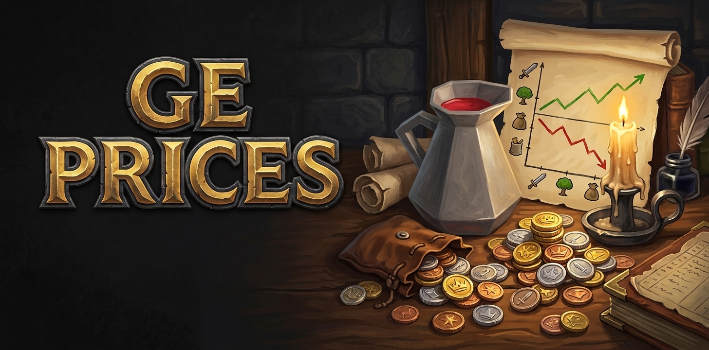
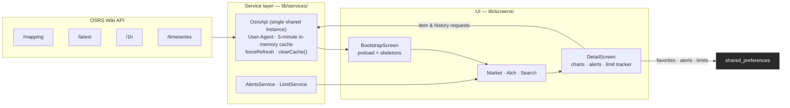

<!--
  ┌──────────────────────────────────────────────────────────────────────────┐
  │  BANNER ZONE — drop the artwork here, then uncomment the <p> below.        │
  │                                                                            │
  │  Spec: docs/assets/banner.png · 1280×640 px (2:1).                         │
  │  Brief: #121212 background, bold "GE Prices" lettering, a one-line         │
  │  tagline, and a medieval-fantasy motif (coins, parchment, candle beside    │
  │  a chart). No Jagex assets, logos, or fonts.                              │
  └──────────────────────────────────────────────────────────────────────────┘
-->
<p align="center"></p>

<p align="center">
  <em>An OSRS Grand Exchange companion for players comparing current prices,<br/>margins, and high-alchemy opportunities.</em>
</p>

<p align="center">
  <a href="https://flutter.dev"></a>
  <a href="https://dart.dev"></a>
  <a href="LICENSE"></a>
  
  
</p>

<p align="center">
  <strong>GE Prices is not affiliated with or endorsed by Jagex Ltd.</strong><br/>
  RuneScape and Old School RuneScape are trademarks of Jagex Ltd. Price data courtesy of the OSRS Wiki.
</p>

---

## Table of Contents

- [Overview](#overview)
- [Features](#features)
- [Screenshots](#screenshots)
- [Architecture](#architecture)
  - [Data flow](#data-flow)
  - [Project layout](#project-layout)
- [How the numbers work](#how-the-numbers-work)
- [Data Source & Credits](#data-source--credits)
- [Tech Stack](#tech-stack)
- [Getting Started](#getting-started)
  - [Requirements](#requirements)
  - [Clone and run](#clone-and-run)
  - [Build a release APK](#build-a-release-apk)
  - [Tests and lint](#tests-and-lint)
- [Quality & Verification](#quality--verification)
- [Roadmap](#roadmap)
- [Contributing](#contributing)
- [Legal Notice](#legal-notice)
- [License](#license)

---

## Overview

**GE Prices** is a lightweight, offline-friendly Grand Exchange price tracker for Old School RuneScape. It reads live item prices, hourly trade volume, and price history from the [OSRS Wiki Real-time Prices API](https://prices.runescape.wiki/) and turns them into decisions players actually make:

- **Flip?** Rank items by net margin after the GE tax.
- **Alch?** Surface items whose high-alchemy value beats their buy price.
- **Where is the money?** Estimate the profit ceiling of a single 4-hour buy-limit window.

There is **no backend, no account, and no tracking**. Everything is fetched on demand, cached in memory for five minutes, and the last good snapshot is kept on disk so the app can open offline; favorites, alerts, and buy-limit timers are stored only on your device.

---

## Features

### 📈 Market
- Live Grand Exchange prices for every mapped item.
- **Most-traded** ranking over the last hour, using RuneLite-reported volume.
- **Best margins** dashboard ranked by *net* profit (after the 2% GE tax); rows with a non-positive net margin are excluded.
- **Buy-limit caps**: the best per-unit profit × buy limit for a single 4-hour window (flips use net margin, alchemy uses alch profit).

### 🕯 Item detail
- Interactive price history with **four time steps** (5m / 1h / 6h / 24h), line and bar views.
- **Crosshair synchronized with volume** so you can read price and units at the same point.
- High-alchemy breakdown, net margins, flip calculator, and an inline buy-limit tracker.

### ⚗️ Alchemy
- High-alchemy profit ranking: `highalch − nature rune (low) − buy price (high)`, assuming a fire staff.
- **F2P / Members filters** and per-item buy-limit potential.
- Nature-rune price is resolved live from the item mapping — never hardcoded.

### 🔔 Alerts & tracking
- **Local price alerts** (above/below thresholds) delivered through background notifications; "below" targets watch the instant-sell price (`low`), and tapping a notification opens the item.
- **Triggered-alert history** — fired alerts keep a timestamp instead of simply disappearing.
- **Volume-spike alerts** (optional): a favorite trading at **3×+ its recent hourly volume** (dump/pump) pings once per day per item; the check runs with the same ~15-minute Workmanager cycle.
- **Set a price target on all favorites at once** from the Search tab's Favorites filter — one sheet creates an above/below alert per favorite.
- **Buy-limit tracker** with the standard 4-hour window per item (manual, since the API doesn't expose your remaining limit).

### ⭐ Quality of life
- Local favorites with membership filters and instant search.
- Dark theme, shimmer skeleton loaders, and honest error states that distinguish a server outage from lost connectivity.
- **Opens offline** from the last saved prices with an honest "offline / last updated" banner instead of an empty error screen.
- Pull-to-refresh and Retry actions force a fresh fetch (on every tab); background auto-refresh stays cache-gated so it never hammers the API.
- **24h % change + trend arrow** (▲/▼) on the Market dashboard's most-traded rows, computed from the item's hourly timeseries (cached 5 minutes).

---

## Screenshots

<!--
  ┌──────────────────────────────────────────────────────────────────────────┐
  │  SCREENSHOT ZONE — capture the four shots below, then uncomment the table. │
  │                                                                            │
  │  Spec: 1080×2400 px on a Samsung Galaxy A53, cropped toward 9:19 and with  │
  │  rounded corners. Files go in docs/assets/. Keep each caption with its shot.│
  └──────────────────────────────────────────────────────────────────────────┘
-->
<!--
<table>
  <tr>
    <td align="center"><br/><em>Market dashboard: top volume, best margins, and buy-limit caps.</em></td>
    <td align="center"><br/><em>Item detail: interactive price chart with synchronized volume.</em></td>
  </tr>
  <tr>
    <td align="center"><br/><em>Alchemy ranking: profit, buy limit, and buy-limit potential.</em></td>
    <td align="center"><br/><em>Item search with membership filters and local favorites.</em></td>
  </tr>
</table>
-->

> No screenshots yet? The placeholder above uncomments into a 2×2 gallery with captions. Until then, this section intentionally renders empty.

---

## Architecture

<!--
  ┌──────────────────────────────────────────────────────────────────────────┐
  │  ARCHITECTURE DIAGRAM ZONE — create docs/assets/architecture.png.          │
  │                                                                            │
  │  Brief (1600×900): three blocks joined by data-flow arrows — Wiki API →    │
  │  service layer (OsrsApi, configured User-Agent, 5-minute in-memory cache)  │
  │  → UI. The UI block contains Market/Alch/Search tabs, DetailScreen charts, │
  │  and favorites stored in shared_preferences.                              │
  └──────────────────────────────────────────────────────────────────────────┘
-->
<!-- <p align="center"></p> -->
<!-- <em align="center">How GE Prices works: Wiki API → OsrsApi service (cache) → screens.</em> -->

### Data flow



A **single shared `OsrsApi` instance** (via `factory OsrsApi()`) owns the cache so every screen sees the same data instead of fragmenting into per-screen caches. `forceRefresh: true` bypasses the cache on pull-to-refresh and Retry; `clearCache()` invalidates it.

### Project layout

```text
ge_prices/
├── assets/                     # App icon and bundled assets
├── docs/assets/                # README banner, screenshots, diagrams
├── lib/
│   ├── main.dart               # Entry point; boots background services on Android
│   ├── models/                 # ItemMapping, ItemPrice, PriceAlert, LimitEntry
│   ├── screens/                # Bootstrap, Home (Market/Alch/Search), Detail, Alerts, Limits, About
│   ├── services/
│   │   ├── osrs_api.dart       # Wiki API client + shared 5-minute cache
│   │   ├── alerts_service.dart # Local price-alert persistence
│   │   ├── price_alerts_background_service.dart  # Workmanager notifications
│   │   └── limit_service.dart  # Buy-limit window persistence
│   ├── theme/                  # Dark theme
│   ├── utils/                  # ge_tax, alchemy_profit, price_format, fetch_errors
│   └── widgets/                # Item tiles, skeletons, "updated" badge
├── test/                       # Unit + app smoke tests
├── tool/                       # check_api.dart, check_icons.dart
└── pubspec.yaml
```

---

## How the numbers work

The app deliberately reuses a single set of formulas so every screen agrees. Canonical implementations live in `lib/utils/`.

| Concept | Formula | Notes |
| --- | --- | --- |
| **GE tax** | `2%` of the sell price (high), capped at `5,000,000 gp` | `lib/utils/ge_tax.dart`. |
| **Net margin** | `sell (high) − buy (low) − GE tax` | Rankings use *net*; non-positive rows are hidden. |
| **Alch profit** | `highalch − nature rune (low) − buy price (high)` | Assumes a fire staff. Nature-rune price resolved from the mapping. |
| **Buy-limit cap** | `per-unit profit × buy limit` | **One 4-hour window**, not a per-day figure. |
| **Volume** | `highPriceVolume + lowPriceVolume` (units) | RuneLite-reported, a lower bound — labelled honestly. |

> **Honesty rules:** windows with no trades are omitted rather than rendered as `0`; missing prices show `—` instead of a fake `0`; and the app never invents a daily figure from hourly-only data.

---

## Data Source & Credits

Price and item-mapping data come from the [OSRS Wiki Real-time Prices API](https://prices.runescape.wiki/) and its [API documentation](https://oldschool.runescape.wiki/w/RuneScape:Real-time_Prices). The app calls the **v2** routes (`/api/v2/osrs/…`), including the `lookback`-based `/timeseries`.

Requests identify themselves with a descriptive User-Agent, as the Wiki requires:

```text
GEPrices/1.0 (Android; + https://github.com/SyberFoxx/OSRS_pricesEx)
```

Hourly traded volume is collected by the **RuneLite** community feed, so it reflects the trades that community observed — treat it as a lower bound, not a complete count of Grand Exchange activity.

---

## Tech Stack

| Layer | Technology | Purpose |
| --- | --- | --- |
| App | Flutter / Dart | Cross-platform UI (Android-first) and app logic. |
| Charts | [`fl_chart`](https://pub.dev/packages/fl_chart) | Historical price charts synchronized with volume. |
| Networking | [`http`](https://pub.dev/packages/http) | OSRS Wiki API requests. |
| Caching | In-memory `OsrsApi` cache + on-disk snapshot | 5-minute TTL shared app-wide; the last good `mapping` / `latest` / `1h` snapshot lets the app open offline. No aggressive polling. |
| Storage | [`shared_preferences`](https://pub.dev/packages/shared_preferences) | Favorites, alerts, buy-limit timers, refresh preference. |
| Notifications | [`flutter_local_notifications`](https://pub.dev/packages/flutter_local_notifications) + [`workmanager`](https://pub.dev/packages/workmanager) | Background price alerts (Android). |
| Images | [`cached_network_image`](https://pub.dev/packages/cached_network_image) | Item icons from the Wiki. |
| Polish | [`shimmer`](https://pub.dev/packages/shimmer) | Skeleton loaders. |
| Platform | [`package_info_plus`](https://pub.dev/packages/package_info_plus), [`path_provider`](https://pub.dev/packages/path_provider), [`url_launcher`](https://pub.dev/packages/url_launcher), [`share_plus`](https://pub.dev/packages/share_plus) | App version, file paths, external links, sharing. |
| Formatting | [`intl`](https://pub.dev/packages/intl) | Number and date formatting. |
| Tooling | [`flutter_launcher_icons`](https://pub.dev/packages/flutter_launcher_icons), [`flutter_native_splash`](https://pub.dev/packages/flutter_native_splash) | Launcher icons and native splash. |

---

## Getting Started

### Requirements

- **Flutter SDK** with Dart `^3.13.5` support.
- **Android:** Android SDK with a configured emulator or a USB-debugging device.
- **Linux desktop:** Flutter's Linux desktop target plus its native build dependencies (CMake, Ninja, Clang, and GTK development libraries).

### Clone and run

```sh
git clone https://github.com/SyberFoxx/OSRS_pricesEx.git
cd OSRS_pricesEx/ge_prices
flutter pub get
```

Run on Linux (fastest iteration target):

```sh
flutter run -d linux
```

Run on Android after connecting a device or starting an emulator:

```sh
flutter devices
flutter run -d <android-device-id>
```

### Build a release APK

Release builds sign with the upload keystore configured in `android/key.properties` (with minify/ProGuard enabled):

```sh
flutter build apk --release
```

> `android/key.properties` and `android/app/upload-keystore.jks` are gitignored — back them up. Without them, the build falls back to debug signing.

### Tests and lint

```sh
flutter analyze          # must be clean
flutter test             # unit + smoke tests
```

### Verify the API outside the app

```sh
dart run tool/check_api.dart
dart run tool/check_icons.dart
```

---

## Quality & Verification

Before a work unit ships, this project checks:

1. `flutter analyze` is clean.
2. `flutter test` is green (utils/services unit tests + app smoke tests).
3. UI/logic changes are exercised with `flutter run -d linux`.
4. Android-only features (notifications, Workmanager, touch, ~360 dp layout, BottomSheets) are verified on a real device.
5. Edge cases hold up: no internet shows a dignified error and never crashes; items with no trades render nulls/`—`; items without a high-alch value or buy limit degrade gracefully; favorites persist after the app is closed.

---

## Roadmap

High level:

- [x] Local price alerts (Workmanager, ~15 min, one-shot).
- [x] Buy-limit tracker.
- [ ] Home-screen widget.
- [ ] English / Spanish localization (`gen-l10n`).
- [ ] iOS release polish and device testing.
- [ ] RuneScape 3 (RS3) data support.
- [ ] Pro billing / backend push — **blocked pending licensing** (see [Legal Notice](#legal-notice)).

The detailed, prioritized task list lives in **[docs/BACKLOG.md](docs/BACKLOG.md)**.

---

## Contributing

Issues and focused pull requests are welcome.

- Keep each change scoped to a single work unit, with a descriptive English commit message (`feat: …`, `fix: …`, `chore: …`).
- Run `flutter analyze` and `flutter test` before opening a PR.
- Reuse the shared `OsrsApi()` singleton and the `lib/utils/` formulas — don't duplicate caches or calculations.
- Do **not** commit official Jagex artwork, logos, or fonts.
- New dependencies require prior discussion.

---

## Legal Notice

GE Prices is fan-made and **non-commercial**.

> Created using intellectual property belonging to Jagex Limited under the terms of Jagex's Fan Content Policy. This content is not endorsed by or affiliated with Jagex.

- RuneScape and Old School RuneScape are trademarks of Jagex Ltd.
- Price and item data courtesy of the OSRS Wiki, licensed **CC BY-NC-SA 3.0**.
- Monetization (paid tiers, ads, or a paid backend) is **intentionally not implemented** and must remain off until a Jagex commercial licence and clear Wiki terms are in place.
- This project ships **no Jagex assets, logos, or art**.

---

## License

This project is licensed under the **MIT License**. See [LICENSE](LICENSE) for details.
