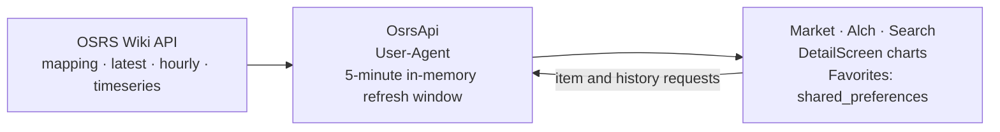

<!-- TODO: crea docs/assets/banner.png (1280x640) y descomenta: -->
<!-- Banner brief: use a #121212 background, bold "GE Prices" lettering, a short tagline, and a medieval-fantasy-inspired visual motif such as coins, parchment, or a candle beside a chart. Do not use official Jagex assets, logos, or fonts. -->
<!-- <p align="center"></p> -->

[](https://flutter.dev) [](https://dart.dev) [](LICENSE)  

GE Prices is an OSRS Grand Exchange companion for players comparing current prices, margins, and high-alchemy opportunities.

*GE Prices is not affiliated with or endorsed by Jagex Ltd. RuneScape and Old School RuneScape are trademarks of Jagex Ltd. Price data courtesy of the OSRS Wiki.*

## Features

- 📈 Live Grand Exchange prices for mapped items.
- 🕯 Historical charts with four time steps, line and bar views, and a crosshair synchronized with volume.
- 💰 Best-margin dashboard with estimated profit after the 2% GE tax.
- 🔥 Most-traded items over one hour, with reported volume.
- ⚗️ High Alchemy profit finder with F2P/Members filters and daily-cap estimates.
- ⭐ Local favorites, dark theme, and shimmer skeleton loaders.

## Screenshots

<!-- Screenshot specs: capture on a Samsung Galaxy A53 at 1080x2400 px. For a consistent presentation, crop toward a 9:19 ratio and round the image corners. Keep each caption with its screenshot. -->
<!-- TODO: Create the four screenshot assets below at 1080x2400 px each, then uncomment this table. -->
<!--
<table>
	<tr>
		<td align="center"><br/><em>Market dashboard: top volume, best margins, and daily caps.</em></td>
		<td align="center"><br/><em>Item detail: interactive price chart with synchronized volume.</em></td>
	</tr>
	<tr>
		<td align="center"><br/><em>Alchemy ranking: profit, buy limit, and daily potential.</em></td>
		<td align="center"><br/><em>Item search with membership filters and local favorites.</em></td>
	</tr>
</table>
-->

## Architecture

<!-- TODO: Create docs/assets/architecture.png (1600x900) and uncomment the image and caption below. -->
<!-- Diagram brief: show three blocks with data-flow arrows: Wiki API -> service layer (OsrsApi, configured User-Agent, and the five-minute in-memory refresh windows maintained by HomeScreen) -> UI. The UI block should contain Market/Alch/Search tabs, DetailScreen with charts, and favorites stored in shared_preferences. -->
<!-- <p align="center"></p> -->
<!-- *How GE Prices works: wiki API -> OsrsApi service (cache) -> screens.* -->



## Data Source & Credits

Price and item-mapping data come from the [OSRS Wiki Real-time Prices API](https://prices.runescape.wiki/) and its [API documentation](https://oldschool.runescape.wiki/w/RuneScape:Real-time_Prices). Requests currently use the User-Agent configured in `OsrsApi`: `ge_prices-dev - prototipo personal`. The wiki asks API clients to identify themselves with a descriptive User-Agent.

Hourly traded volume is reported through data collected with the RuneLite client. It reflects the trades observed by that community data feed, so treat it as a lower-bound indicator rather than a complete count of all Grand Exchange activity. The app currently calls the API's v1 routes; check the documentation for route and schema changes.

## Install

### Requirements

- Flutter SDK with Dart `^3.13.5` support.
- Android: Android SDK and a configured emulator or USB-debugging device.
- Linux desktop: Flutter's Linux desktop target and its native build dependencies (including CMake, Ninja, Clang, and GTK development libraries).

### Clone and run

```sh
git clone <repository-url>
cd ge_prices
flutter pub get
```

Run on Linux:

```sh
flutter run -d linux
```

Run on Android after connecting a device or starting an emulator:

```sh
flutter devices
flutter run -d <android-device-id>
```

## Tech Stack

| Technology | Purpose |
| --- | --- |
| Flutter / Dart | Cross-platform application and UI. |
| `fl_chart` | Historical price charts and volume visualization. |
| `shimmer` | Loading skeletons. |
| `cached_network_image` | Item icons. |
| `shared_preferences` | Local favorites and refresh preferences. |
| `url_launcher` | Open item pages on the OSRS Wiki. |
| `flutter_launcher_icons` | Generate launcher icons from the project icon. |
| `flutter_native_splash` | Generate the Android native splash screen. |
| `http` / `intl` | Wiki API requests and number/date formatting. |

## Roadmap

- [ ] iOS release polish and device testing.
- [ ] Price alerts.
- [ ] Home-screen widget.
- [ ] RuneScape 3 (RS3) data support.
- [ ] English/Spanish localization.

## Contributing

Issues and focused pull requests are welcome. Please keep changes scoped, run `flutter analyze`, and add or update tests for behavior changes. Do not include official Jagex artwork, logos, or fonts in contributions.

## License

This project is licensed under the MIT License. See [LICENSE](LICENSE) for details.
